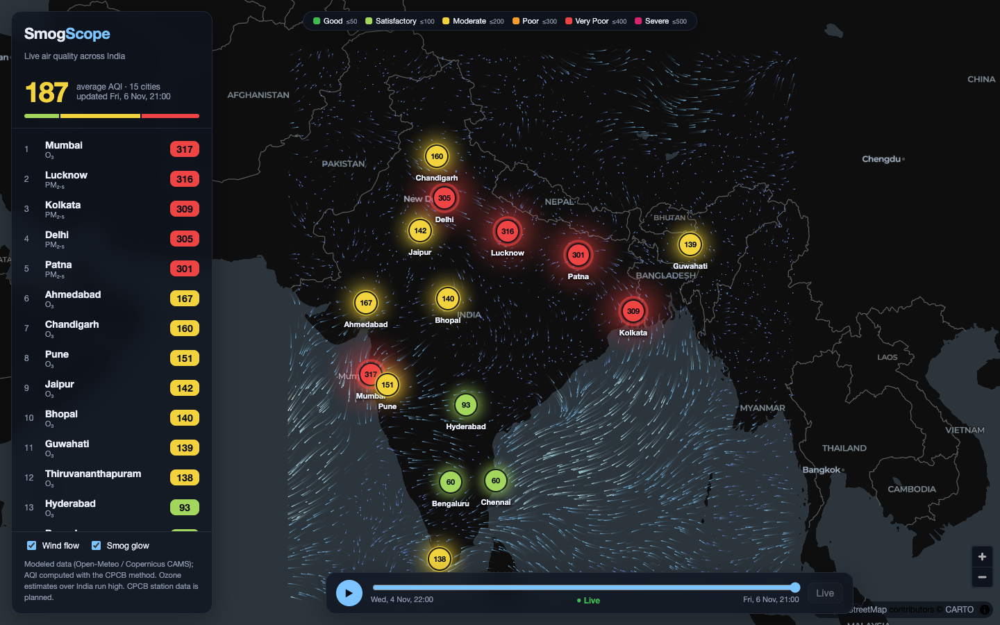
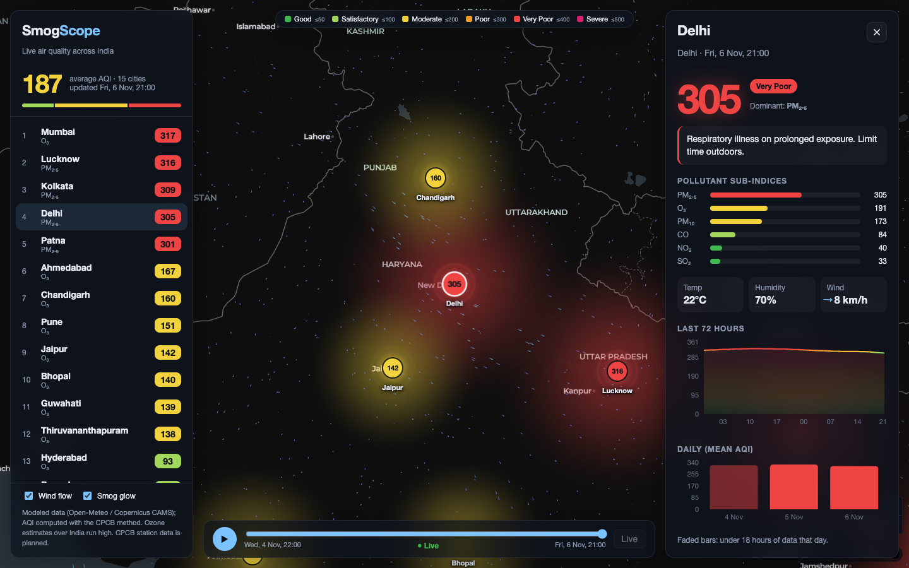
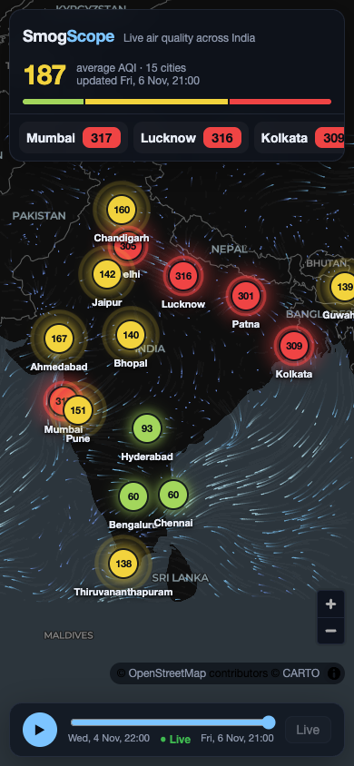

# SmogScope

Live air quality and wind across India. A data pipeline collects pollution and weather data,
checks its quality, computes the **official Indian National AQI** (CPCB method), and serves it
through an API to an animated map dashboard.



> **Status:** Phases 1–4 are complete (pipeline, data quality, API, animated frontend).
> ML forecasting and satellite analysis are next. Every design decision is explained in
> [`docs/design-qa.md`](docs/design-qa.md).

## Features

- **Animated wind flow:** thousands of particles moving through a real wind field (bilinear interpolation over a 2° grid)
- **AQI markers** in CPCB colors that pulse faster as the air gets worse, plus a "smog glow" around each city
- **72-hour playback:** scrub or play through the last three days on the map
- **City panel:** animated AQI, health advice, pollutant sub-indices, weather, a 72-hour chart colored by category, and daily summaries
- **Data quality:** flags impossible values, stuck sensors, and PM2.5 > PM10. Flagged data is kept but never used for the AQI.
- Works on phones; respects *reduced motion* settings

<p>
  
  
</p>

## Data sources

| Source | Type | Coverage | Key needed |
|---|---|---|---|
| [CPCB via data.gov.in](https://www.data.gov.in/resource/real-time-air-quality-index-various-locations) | Measured, from about 500 ground stations | Official, but stations are clustered in big cities | Yes (free) |
| [Open-Meteo](https://open-meteo.com/) | Modeled (Copernicus CAMS) air quality, weather, wind | Every location, hourly | No |

## Architecture

```
                 ┌──────────── scheduler (every 30 min) ────────────┐
Open-Meteo ─┐    │ fetch → store raw → quality flags → hourly AQI   │
CPCB ───────┴──▶ │       → daily summaries                          │──▶ SQLite (WAL)
                 └──────────────────────────────────────────────────┘        │
                                                                             ▼
                 Browser ◀── React + MapLibre + canvas ◀── FastAPI (read-only) ◀─┘
                                                            └─ /api/wind (cached 1 h, Open-Meteo)
```

| Layer | Tech |
|---|---|
| Pipeline | Python, pandas, requests, APScheduler |
| Storage | SQLite (WAL mode); moving to PostgreSQL + TimescaleDB later |
| API | FastAPI, Pydantic, uvicorn |
| Frontend | React 19, TypeScript, Vite, MapLibre GL, Canvas 2D, Framer Motion, Recharts |
| Tests | pytest (75), Vitest (3) |

## Quick start

```bash
# Backend
python3 -m venv .venv && source .venv/bin/activate
pip install -r requirements.txt
cp .env.example .env                      # optional: data.gov.in API key for CPCB data

python -m aqi_india.pipeline              # one run: fetch, check, compute, store
python -m aqi_india.scheduler             # keep collecting every 30 min (leave running)

# Frontend (development, with hot reload)
uvicorn aqi_india.api:app --reload        # API on :8000, docs at http://localhost:8000/docs
cd web && npm install && npm run dev      # app on http://localhost:5173

# Production-style: build once, FastAPI serves everything on :8000
cd web && npm run build && cd .. && uvicorn aqi_india.api:app

# Tests and docs
pytest && (cd web && npm test)
./docs/build.sh                           # design Q&A -> docs/build/design-qa.{docx,pdf}
```

## API

| Endpoint | Returns |
|---|---|
| `GET /api/cities` | Latest AQI + weather per city, worst first |
| `GET /api/overview` | National average, cities per category, worst/best |
| `GET /api/cities/{city}/history?hours=72` | Hourly AQI and clean pollutant readings |
| `GET /api/cities/{city}/daily?days=14` | Daily summaries with coverage and data quality |
| `GET /api/timeline?hours=72` | Every city's hourly AQI on one time axis (map playback) |
| `GET /api/wind` | u/v wind grid over India (cached for 1 hour) |

Interactive documentation: `http://localhost:8000/docs`.

## Findings so far

- **Modeled ozone is unreliable over India.** Open-Meteo/CAMS reported hourly O₃ of up to about 520 µg/m³ in Mumbai,
  which makes ozone the "dominant pollutant" in most cities. PM2.5 estimates look plausible: Delhi, Kolkata, Lucknow and
  Patna were above 300 ("Very Poor") in early November. Comparing against CPCB station measurements is planned.
- **The government API is unreliable.** data.gov.in often hangs or returns HTTP 502, so the CPCB fetcher retries with
  backoff and the pipeline continues with the other source.
- **Model output can look like a stuck sensor:** Chennai's modeled O₃ sat at exactly 36.0 for 6 hours (design-qa Q18).

## Roadmap

- [x] Phase 1: ingestion, storage, CPCB AQI calculator
- [x] Phase 2: data-quality flags, hourly AQI history, daily summaries *(CPCB vs. modeled comparison pending CPCB uptime)*
- [x] Phase 3: FastAPI backend
- [x] Phase 4: React frontend with wind particles, smog glow, playback
- [ ] Phase 5: anomaly detection, AQI forecasting (scikit-learn vs. PyTorch LSTM), bias correction
- [ ] Phase 6: satellite data: fire hotspots, smoke segmentation, PM2.5 where there are no stations
- [ ] Phase 7: PostgreSQL + TimescaleDB, Docker, deployment, alerts

Map data © OpenStreetMap contributors, basemap © CARTO. Air quality and weather © Open-Meteo (CAMS / national weather services).
