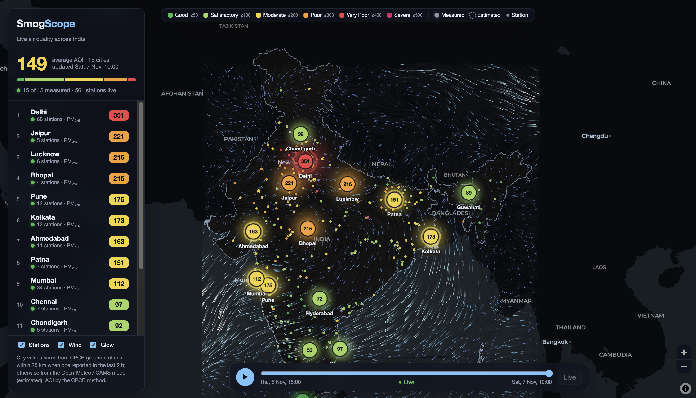
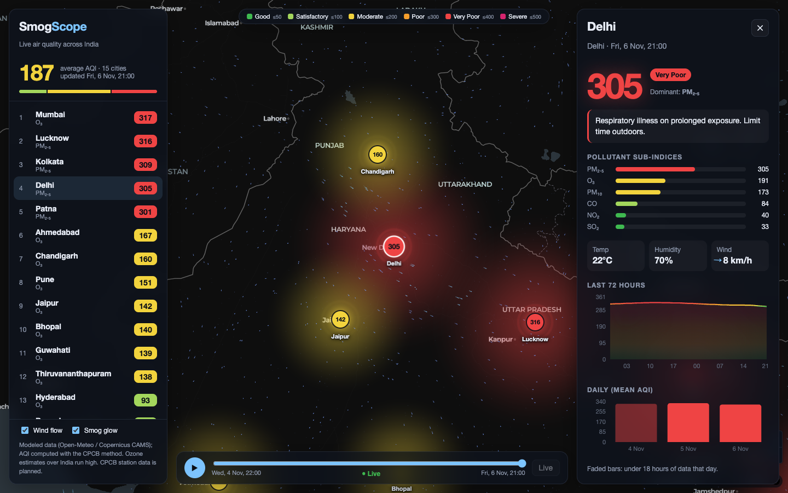
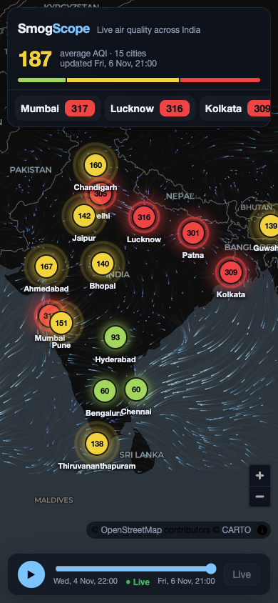

# SmogScope

Live air quality and wind across India. A data warehouse collects **government ground-station measurements (CPCB)**
and **modeled estimates (Open-Meteo / CAMS)**, cleans them through bronze → silver → gold layers in PostgreSQL,
computes the **official Indian National AQI** (CPCB method), and serves it through an API to an animated map dashboard.



> **Status:** Phases 1–4 are complete (pipeline, data quality, API, animated frontend), and the backend now runs on a
> PostgreSQL medallion warehouse with ~560 CPCB stations. **Live at <https://54.79.229.29.sslip.io/>** (AWS EC2, HTTPS).
> ML forecasting and satellite analysis are next. Every design decision is explained in [`docs/design-qa.md`](docs/design-qa.md).

## Features

- **Every CPCB station on the map:** ~560 government monitoring stations as dots in their AQI color; click one for its pollutant sub-indices
- **Measured first, estimated where needed:** each city shows the average of its stations within 25 km when one reported
  in the last 2 hours (solid ring), otherwise the model estimate (dashed ring)
- **Stations vs. model:** every city panel shows how far the model is from the ground truth
- **Animated wind flow:** thousands of particles moving through a real wind field (bilinear interpolation over a 2° grid)
- **AQI markers** in CPCB colors that pulse faster as the air gets worse, plus a "smog glow" around each city
- **72-hour playback:** scrub or play through the last three days on the map (measured hours where available)
- **City panel:** animated AQI, health advice, range across stations, pollutant sub-indices, weather, a 72-hour chart
  (model line, station dots), and daily summaries
- **Data quality:** flags impossible values, stuck sensors, and PM2.5 > PM10. Flagged data is kept but never used for the AQI.
- **India's official boundary** (Survey of India), including all of Jammu & Kashmir and Ladakh, drawn over the basemap and tested
- Works on phones; respects *reduced motion* settings

<p>
  
  
</p>

## Data sources

| Source | Type | Coverage | Key needed |
|---|---|---|---|
| [CPCB via data.gov.in](https://www.data.gov.in/resource/real-time-air-quality-index-various-locations) | **Measured** at ~560 ground stations; published as pollutant **sub-indices**, latest snapshot only | Official, but clustered in cities | Yes (free) |
| [Open-Meteo](https://open-meteo.com/) | **Modeled** (Copernicus CAMS) concentrations, weather, wind | Anywhere, hourly, with history | No |

## Architecture

```
                         scheduler (every 30 min) — python -m aqi_india.scheduler
                                          │
   CPCB (8 pages) ─┐                      ▼
   Open-Meteo AQ ──┼─▶ 🥉 bronze   raw JSON, insert-only, one ingest_run row per fetch
   Open-Meteo wx ──┘        │
                            ▼  transform: types, units, "NA"→NULL, de-duplicate, quality flags
                    🥈 silver   location · air_quality (concentration | sub_index) · weather
                            │
                            ▼  compute: CPCB AQI, station AQI, daily summaries
                    🥇 gold     aqi_hourly · daily_summary · views: city_station, city_best
                            │
                            ▼
   Browser ◀── React + MapLibre + canvas ◀── FastAPI (read-only) ── /api/wind (cached 1 h, Open-Meteo)
```

| Layer | Tech |
|---|---|
| Warehouse | PostgreSQL 17 (bronze/silver/gold schemas, `jsonb`, views), psycopg 3, numbered SQL migrations |
| Pipeline | Python, pandas, requests, APScheduler |
| API | FastAPI, Pydantic, uvicorn |
| Frontend | React 19, TypeScript, Vite, MapLibre GL, Canvas 2D, Framer Motion, Recharts |
| Tests | pytest (API tests run against a throwaway PostgreSQL database built from the migrations), Vitest |

## Quick start

```bash
# 1. PostgreSQL (macOS)
brew install postgresql@17 && brew services start postgresql@17
createdb smogscope
for f in sql/0*.sql; do psql -d smogscope -f "$f"; done   # migrations, in order

# 2. Python
python3 -m venv .venv && source .venv/bin/activate
pip install -r requirements.txt
cp .env.example .env                      # data.gov.in API key for CPCB data

python -m aqi_india.warehouse             # one refresh: bronze -> silver -> gold
python -m aqi_india.scheduler             # keep refreshing every 30 min (leave running)

# 3. Frontend: build once, FastAPI serves everything on :8000
cd web && npm install && npm run build && cd ..
uvicorn aqi_india.api:app                 # http://127.0.0.1:8000 · API docs at /docs

# Development with hot reload instead (two terminals)
uvicorn aqi_india.api:app --reload        # terminal 1: API on :8000
cd web && npm run dev                     # terminal 2: app on http://localhost:5173

# Tests and docs
pytest && (cd web && npm test)
ruff check aqi_india tests                # Python lint (pyproject.toml)
(cd web && npm audit --omit=dev)          # runtime dependency audit
./docs/build.sh                           # design Q&A -> docs/build/design-qa.{docx,pdf}
```

The database location can be changed with `SMOGSCOPE_PG_DSN` (default `dbname=smogscope`).

## Deployment

The live site runs three services (`db`, `scheduler`, `web`) plus **Caddy** for HTTPS on a single AWS EC2 instance in
Sydney (`ap-southeast-2`). Caddy obtains and renews a Let's Encrypt certificate automatically for the Elastic IP's
`sslip.io` hostname, and redirects HTTP to HTTPS.

```bash
# On the server, from the repo directory (secrets live in .env, chmod 600):
docker compose -f docker-compose.yml -f docker-compose.prod.yml up -d --build

# Logs / status
docker compose -f docker-compose.yml -f docker-compose.prod.yml ps
docker compose logs -f caddy scheduler
```

Server-specific `.env` values: `STATION_FEED=openaq` (data.gov.in is geo-blocked outside India),
`SITE_ADDRESS=<elastic-ip>.sslip.io`, `WEB_BIND=127.0.0.1`, and `WEB_PORT=8080` (port 80 belongs to Caddy).
The production override also pins `api.open-meteo.com` to a reachable address (`OPEN_METEO_IP`) because the
geo-DNS answer for Sydney intermittently hangs during the TLS handshake.

AWS infrastructure (security group, key pair, instance, Elastic IP) is managed with Terraform in `infra/`:

```bash
cd infra
terraform init
terraform plan     # after import: "No changes"
```

`infra/terraform.tfvars` (git-ignored) holds your home IP for SSH:

```hcl
my_ip = "203.0.113.10"   # curl -s https://checkip.amazonaws.com
```

Daily backups (7-day retention): `deploy/backup.sh`; install it with
`0 3 * * * /home/ubuntu/smogscope/deploy/backup.sh` in the server's crontab.

## API

| Endpoint | Returns |
|---|---|
| `GET /api/cities` | Latest AQI per city, worst first: `basis` (measured/estimated), station count and range, model vs. measured gap, weather |
| `GET /api/stations` | Every CPCB station that reported in the last 24 h, with sub-indices and AQI |
| `GET /api/overview` | National average, cities per category, how many measured, worst/best |
| `GET /api/cities/{city}/history?hours=72` | Hourly model AQI, measured points, clean pollutant concentrations |
| `GET /api/cities/{city}/daily?days=14` | Daily summaries with coverage and data quality |
| `GET /api/timeline?hours=72` | Every city's hourly AQI on one time axis (map playback), measured hours preferred |
| `GET /api/wind` | u/v wind grid over India (cached for 1 hour) |
| `GET /api/health` | Newest AQI hour, per-source status/age, and an overall `ok` / `degraded` / `failed` |

Interactive documentation: `http://localhost:8000/docs`.

## Findings so far

- **The model is far from the stations.** In the first comparison (7 Nov, all 15 cities measured) the Open-Meteo/CAMS
  AQI was off by **~75 points on average** and in the right category for only **6 of 15** cities. Mumbai was overestimated
  by **+208** (modeled ozone runs high over India); Delhi was **underestimated by 124** (the model misses local sources).
  This error is the target for Phase 5's ML bias correction.
- **One city, many airs:** Delhi's 68 stations ranged from AQI **226 to 449** at the same hour.
- **CPCB publishes sub-indices, not concentrations.** CO values up to 161 (impossible in mg/m³), nothing above 500, and
  0 decimals in 3,658 values. Treating them as concentrations would have computed every AQI wrong (design-qa Q40).
- **data.gov.in's "outage" was a bot filter.** It answers the default `python-requests` User-Agent with a fake 502 after 60 s,
  and throttles bursts with an empty "200 OK". Diagnosed by changing one variable at a time (design-qa Q39).
- **Model output can look like a stuck sensor:** Chennai's modeled O₃ sat at exactly 36.0 for 6 hours (design-qa Q18).

## Roadmap

- [x] Phase 1: ingestion, storage, CPCB AQI calculator
- [x] Phase 2: data-quality flags, hourly AQI history, daily summaries, CPCB vs. modeled comparison
- [x] Phase 3: FastAPI backend
- [x] Phase 4: React frontend with wind particles, smog glow, playback, station layer
- [x] PostgreSQL bronze/silver/gold warehouse (pulled forward from Phase 7)
- [ ] Phase 5: anomaly detection, AQI forecasting (scikit-learn vs. PyTorch LSTM), model bias correction from station data
- [ ] Phase 6: satellite data: fire hotspots, smoke segmentation, PM2.5 where there are no stations
- [ ] Phase 7: TimescaleDB, Docker, deployment, alerts

Map data © OpenStreetMap contributors, basemap © CARTO. India boundary: Survey of India via [DataMeet](https://github.com/datameet/maps) (CC-BY-SA 2.5 / ODbL; the simplified file in `web/public/` carries the same license). Air quality: CPCB via data.gov.in (Government Open Data License – India); Open-Meteo (CAMS / national weather services).
